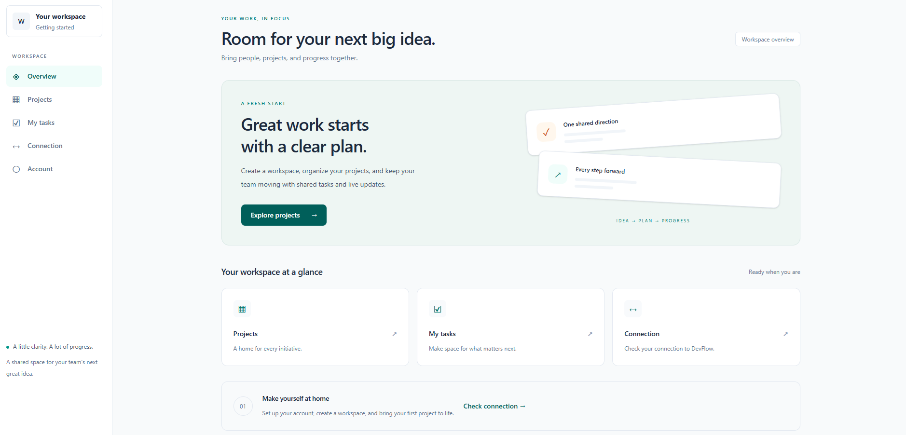
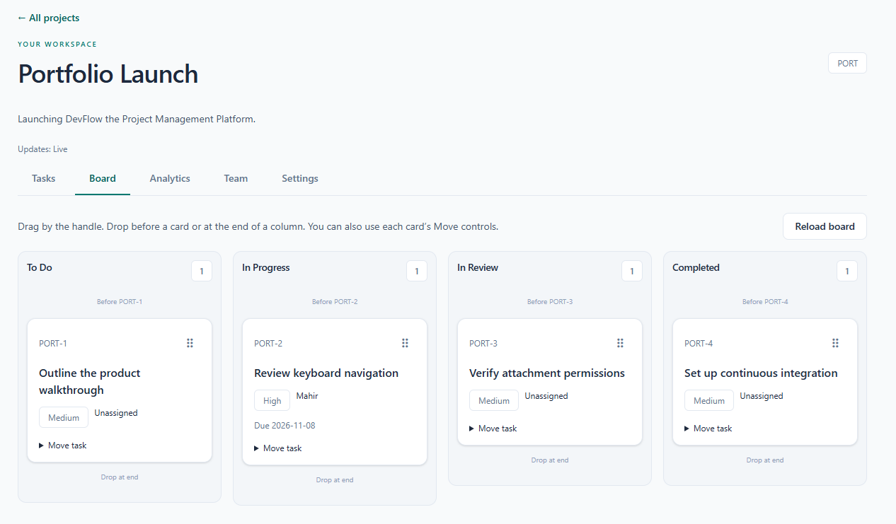
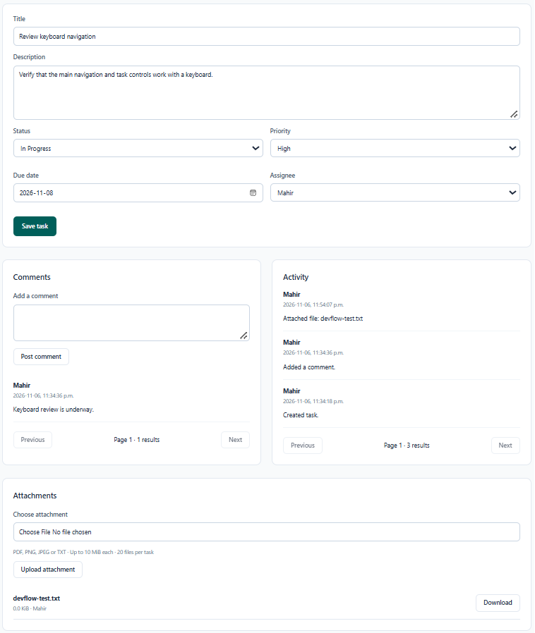
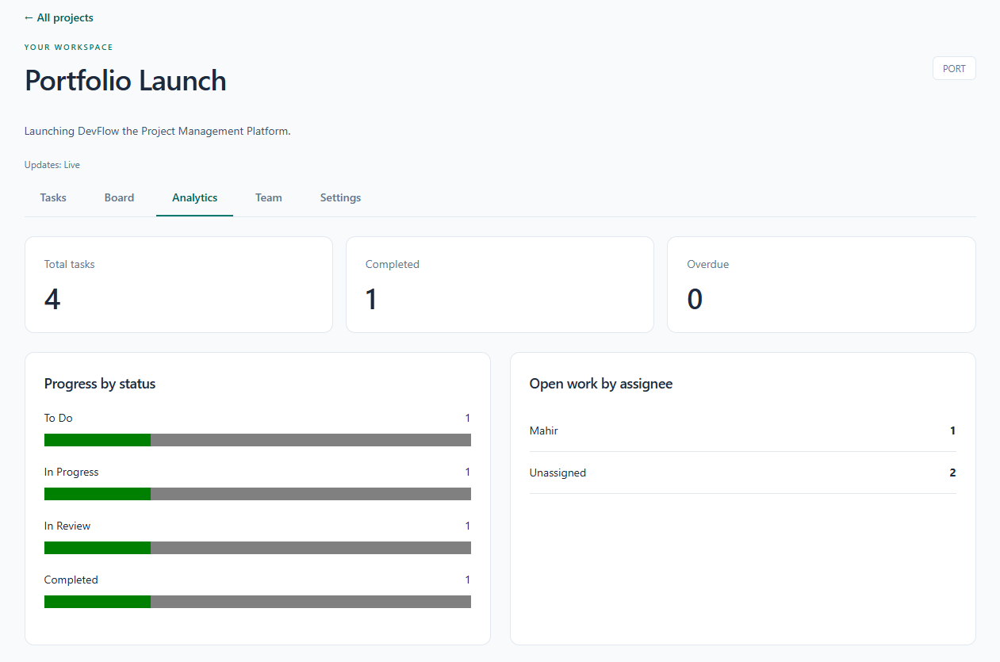
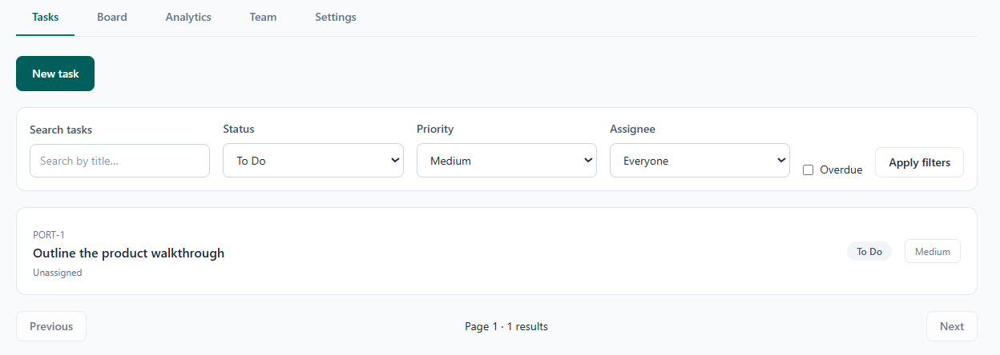
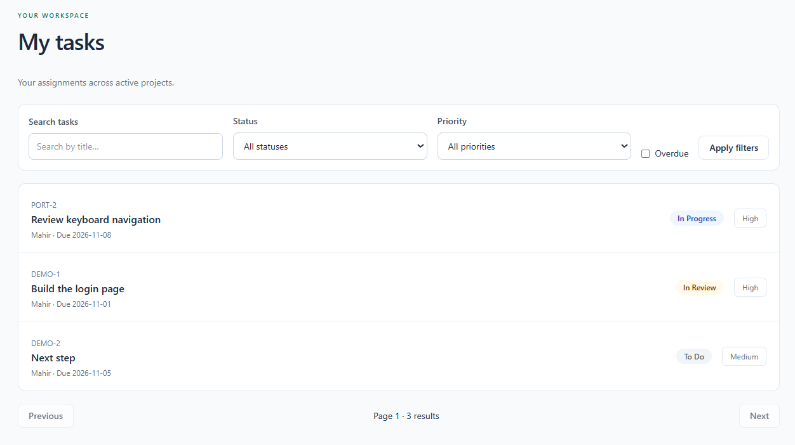
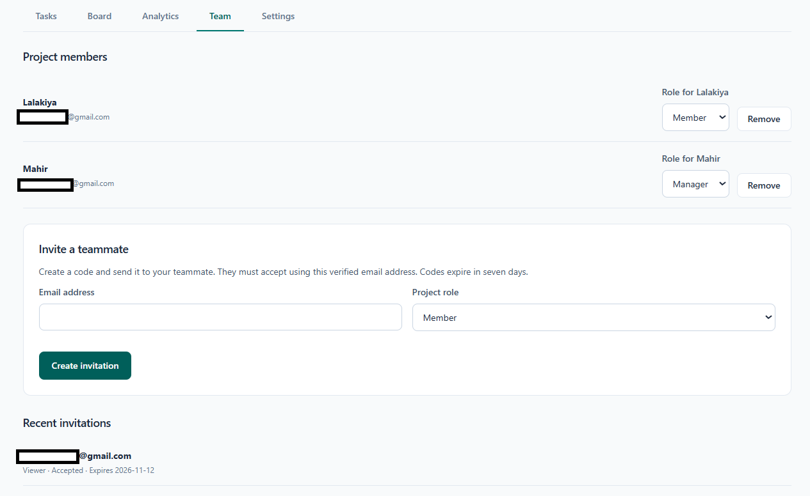
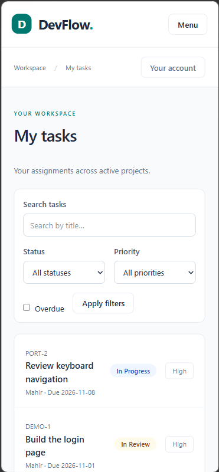

# DevFlow — Cloud-Based Project Management Platform

[](https://github.com/mahirp22/DevFlow-Project-Management-Platform/actions/workflows/ci.yml)

A full-stack project management application built with React, TypeScript, ASP.NET Core, and PostgreSQL. DevFlow helps teams organize projects, assign tasks, track progress on a Kanban board, and collaborate through real-time updates.

The goal of this project was to practice building a complete application from the database and REST API to the frontend, authentication, file storage, automated testing, and deployment configuration.

**Hosting status:** the frontend, API, and PostgreSQL run locally. AWS Cognito and S3 are working integrations for authentication and attachments. ECS Fargate, RDS, and S3/CloudFront hosting are defined in infrastructure code but are not deployed. Paid deployment is disabled by default.

## 📦 Technologies

### Frontend

- React and TypeScript
- Vite and Tailwind CSS
- React Router
- TanStack Query for server state
- dnd-kit for drag-and-drop interactions

### Backend & Database

- C# and ASP.NET Core Web API
- Entity Framework Core and PostgreSQL
- RESTful APIs and OpenAPI documentation
- SignalR for real-time communication

### AWS & Development Tools

- AWS Cognito for authentication
- AWS S3 for private file attachments
- CloudFormation configuration for ECS Fargate, RDS, and S3/CloudFront hosting
- Docker, Git, and GitHub Actions
- xUnit, Vitest, and React Testing Library

## 💡 Features

Here's what you can do with DevFlow:

### 🗂️ Workspaces & Projects

- Create team workspaces and organize work into projects
- Invite teammates and manage project membership
- Control project access through roles enforced by the API

### ✅ Task Management

- Create and edit tasks with descriptions, priorities, deadlines, and assignees
- Search tasks and filter by status, priority, assignee, or overdue work
- View personal assignments across projects

### 📋 Kanban Board & Real-Time Collaboration

- Move tasks through To Do, In Progress, In Review, and Completed
- Reorder cards using drag-and-drop or labelled Move controls
- Receive SignalR notifications that refresh project data
- Detect conflicting edits instead of silently overwriting another user's changes

### 💬 Comments & Attachments

- Discuss tasks through comments and review their activity history
- Upload private PDF, PNG, JPEG, and TXT attachments to S3
- Verify uploaded files before finalizing attachment records
- Download attachments through short-lived links after project authorization

### 📊 Analytics & Responsive Design

- View task totals, completion counts, overdue work, and progress by status
- See open work grouped by assignee
- Use layouts that adapt to narrow screens
- Navigate with keyboard controls and visible focus indicators

## 🧱 How It Works

1. The user signs in through AWS Cognito using authorization code flow with PKCE.
2. The React frontend sends authenticated requests to the ASP.NET Core API.
3. The API validates the token, checks membership and permissions, and accesses PostgreSQL through Entity Framework Core.
4. When project data changes, SignalR notifies connected clients so they can fetch updated data.
5. For attachments, the API authorizes an upload, the browser sends the file directly to S3, and the API verifies the stored file before recording it as ready.

The backend uses separate Domain, Application, Infrastructure, and API layers. Dependency injection connects these layers, while DTOs, request validation, centralized error handling, and structured logging keep request processing consistent.

## 📁 Project Structure

| Directory | Purpose |
| --- | --- |
| `frontend/` | React pages, components, API integration, and frontend tests |
| `backend/src/DevFlow.Domain/` | Core entities and domain rules |
| `backend/src/DevFlow.Application/` | Application contracts and DTOs |
| `backend/src/DevFlow.Infrastructure/` | EF Core persistence and external service integrations |
| `backend/src/DevFlow.Api/` | REST endpoints, authorization, and SignalR |
| `backend/src/DevFlow.Migrator/` | Separate database migration runner |
| `backend/tests/` | Backend unit and integration tests |
| `infrastructure/` | Database and AWS infrastructure configuration |
| `scripts/` | Verification, container checks, and release tooling |
| `docs/` | Architecture, setup guides, screenshots, and project milestones |

## 🚦 Running the Project Locally

Clone the repository and enter its folder:

```powershell
git clone https://github.com/mahirp22/DevFlow-Project-Management-Platform.git
Set-Location DevFlow-Project-Management-Platform
```

Requirements: .NET SDK **10.0.403**, Node.js **24.22.1**, npm **11.19.1**, PostgreSQL **18.6**, and Docker Desktop with Linux containers for container tests. Versions are pinned in global.json, .node-version and lock files.

1. Follow [development setup](docs/development.md) and [database setup](docs/phase-2.md). Start PostgreSQL and configure the connection string before EF commands.
2. Configure Cognito using [Phase 4](docs/phase-4.md). Copy frontend/.env.example to ignored frontend/.env.local and use your own public Cognito identifiers. Backend credentials belong in User Secrets or process configuration, never Git.
3. From the repository root, restore/build and apply migrations:

```powershell
dotnet restore backend/DevFlow.slnx --locked-mode
dotnet tool restore
dotnet build backend/DevFlow.slnx --no-restore
dotnet ef database update --project backend/src/DevFlow.Infrastructure --startup-project backend/src/DevFlow.Api --no-build
dotnet run --project backend/src/DevFlow.Api --launch-profile http --no-build
```

4. In a second terminal:

```powershell
Set-Location frontend
npm.cmd ci
npm.cmd run dev
```

Open **http://localhost:5173**. Vite forwards `/api` and WebSockets to the API on 127.0.0.1:5080. For attachments, complete [S3 setup](docs/phase-7.md); the earlier features remain usable without storage configuration. Cognito/S3 usage is not guaranteed to be free.

If dotnet is not on PATH in the original workspace, use the local SDK setup documented in the phase guides. A fresh clone should install the pinned SDK. Stop Vite before npm ci on Windows if native dependencies are locked.

## 🍿 Demo & Screenshots

Real screenshots from the locally running application with sample project data. The mobile view was captured using browser device emulation.





<details>
<summary>Task details, comments and an S3 attachment</summary>



</details>

<details>
<summary>Project analytics</summary>



</details>

<details>
<summary>Task filtering and personal assignments</summary>





</details>

<details>
<summary>Project team and roles</summary>



</details>

<details>
<summary>Mobile layout</summary>



</details>

## 🧪 Testing & CI

The project includes frontend component tests, backend unit tests, PostgreSQL integration tests, and container readiness checks. GitHub Actions runs frontend, backend, and container jobs for the public repository.

From the repository root, with Docker Desktop running, run the complete verification script:

```powershell
powershell -NoProfile -ExecutionPolicy Bypass -File .\scripts\Verify.ps1 -IncludeContainers
```

The frontend build also checks a 125,000-byte gzip budget for initial JavaScript. Routes load on demand so project and board code is fetched when needed.

For a local release ZIP and SHA256 manifest, run `scripts/New-LocalRelease.ps1`. It verifies the project before writing to ignored `.artifacts/`; it does not upload or deploy anything. Private repositories skip hosted jobs under the current no-paid-runner policy.

View workflow results in [GitHub Actions](https://github.com/mahirp22/DevFlow-Project-Management-Platform/actions/workflows/ci.yml).

## 📚 What I Learned

This project gave me practice connecting frontend, backend, database, and cloud services into one application.

### 🧱 Full-Stack Architecture

- Separating UI, API, application contracts, and persistence responsibilities
- Designing REST endpoints with validation, useful status codes, and consistent errors
- Managing schema changes through database migrations

### 🔐 Authentication & Authorization

- Integrating Cognito without storing user passwords in the application
- Distinguishing user identity from workspace and project permissions
- Enforcing authorization in the backend as well as reflecting it in the interface

### ⚡ Real-Time Data & File Storage

- Keeping client state synchronized through notifications and query refetching
- Handling concurrent edits and reconnecting clients
- Using constrained S3 uploads and verifying file metadata before finalization

### 🛠️ Testing & Delivery

- Testing persistence against PostgreSQL and checking API behavior
- Packaging the application with Docker and automating checks through GitHub Actions
- Separating migration credentials from runtime database permissions
- Measuring initial JavaScript size and deferring route code

## 🧪 Future Improvements

- Add a SignalR backplane before running multiple API instances
- Add malware scanning or quarantine for uploaded attachments
- Measure database queries and application behavior under realistic load
- Extend accessibility checks with screen readers and real mobile devices
- Deploy the prepared AWS hosting infrastructure when a hosting budget is available

The current board is limited to 500 cards. Screenshots show the implemented interface; they do not establish production performance, accessibility certification, or real-time delivery by themselves.

## 📖 Documentation

- [System architecture](docs/architecture.md)
- [Database model](docs/data-model.md)
- [Development setup](docs/development.md)
- [Demo walkthrough](docs/demo.md)
- [Portfolio case study and interview preparation](docs/portfolio.md)
- [Operations, backups, and local releases](docs/operations.md)
- [Performance changes and validation](docs/phase-10.md)
- [Development roadmap](docs/roadmap.md)
